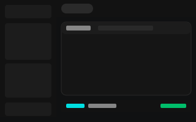

# Farrier

A Herdr layout, two mods and its theme.

Farrier is a keyboard-first window for running coding agents: spaces and agents
on the left, framed panes with a header in the middle, and a bottom strip that
says how many agents wait on you, work, or finished while you looked elsewhere.
The **Changes** button in the tab bar opens a Changes panel: staged files,
branches, stashes, a push/pull/fetch menu and a commit box that can use Pi to
write the message.



Not affiliated with Herdr.

## Install

Farrier installs from a clone; the app stays open while it runs.

```powershell
git clone https://github.com/Arctic07/herdr-farrier
cd herdr-farrier
powershell -ExecutionPolicy Bypass -File install.ps1
```

```sh
git clone https://github.com/Arctic07/herdr-farrier
cd herdr-farrier
sh install.sh
```

Both scripts copy the layout, its picture, the theme and the mod into
`~/.config/herdr-app` (or `$HERDR_APP_HOME`), back up anything they replace, and
check every mod with `herdr-app check`.

Then open Herdr, pick **farrier** in Settings › Layout, or cycle layouts with
`Ctrl+Shift+L`.

Options:

| Flag | What it does |
|---|---|
| `--list` | what this repository installs |
| `--dry-run` | print every write, touch nothing |
| `--update` | update what is already installed, nothing new |
| `--remove` | take back what Farrier installed, and its keys |
| `--keys` | add the layout's keys to `keys.json`, only where nothing is bound |
| `-y` | no questions |
| `farrier-mod` | install only these ids (see `--list`) |

Running it twice is safe: anything already identical is left alone (`=`).

## What's inside

| File | What it is |
|---|---|
| `layouts/farrier.json` | the window: sidebar, tabs, framed panes, hidden Changes panel, bottom strip |
| `layouts/farrier.svg` | the picture Settings shows for the layout |
| `themes/farrier.json` | dark leather and brass; offered only in this layout |
| `mods/farrier/` | the bottom strip: machine, space, branch, agents waiting |
| `mods/farrier-git/` | the Changes panel: staged files, branches, diff window, commit box |
| `keys.pack.json` | the layout's key section, merged only with `--keys` |
| `install.tsv` | what gets installed, and where |
| `reserved.txt` | the names Herdr ships, which Farrier refuses to take |
| `VERSION` | the one version the installers print |

## Keys

The strip's key lives in the `layout:farrier` section, so it works only while
this layout shows and never takes a key from someone else's window.

| Key | Does |
|---|---|
| `Ctrl+Shift+A` | go to the next agent that needs you |

Clicking a count in the strip goes to an agent in that state.

## Uninstall

```powershell
powershell -ExecutionPolicy Bypass -File install.ps1 --remove
```

```sh
sh install.sh --remove
```

`--remove` deletes only the files `install.tsv` lists and the key bindings that
are still Farrier's own, and leaves the rest of the Herdr home alone. Switch to
another layout first if Farrier is the shown one. To do it by hand, delete
`layouts/farrier.json`, `layouts/farrier.svg`, `themes/farrier.json`,
`mods/farrier/` and `mods/farrier-git/` from the Herdr home, and the
`layout:farrier` section from `keys.json`.

## Requirements

- Herdr app 0.1.16 or newer
- Windows PowerShell 5.1 or POSIX `sh`, nothing else; `python3` is used only if
  it is already there, to merge keys
- For commit messages written by Pi: `pi` on `PATH`, using the model in
  `~/.pi/agent/settings.json`

## Development

```sh
node scripts/check.mjs        # catalogue, names, JSON, references, keys
sh tests/install.test.sh      # installer behaviour in throwaway homes
```

Node is a developer and CI tool. Neither installer needs it, `python3`, or a
package manager.

## License

Apache-2.0. See `LICENSE` and `NOTICE`.
